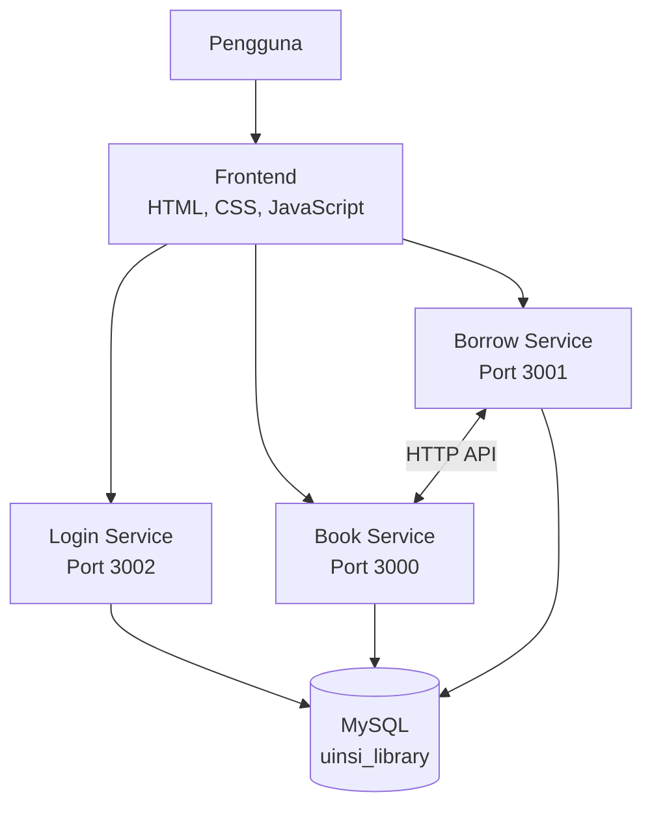

# UINSI Library — Sistem Peminjaman Buku

Proyek sistem peminjaman buku Kelompok 3 yang dikembangkan menggunakan arsitektur **microservice**. Aplikasi terdiri dari frontend berbasis HTML, CSS, dan JavaScript serta tiga service yang berkomunikasi melalui HTTP API. Data utama disimpan menggunakan MySQL.

## Anggota Kelompok

1. Muhammad Randy Maulana
2. Sofyan Al-Buqori Ramli
3. Hafiz Izzan Zaafarani
4. Exan Nabil Rifai
5. Cikal Fachri Amanta

## Fitur dan Service

### 1. Login Service

Login Service menangani proses login mahasiswa.

- Memvalidasi `studentId` dan `name`.
- Mengembalikan data pengguna jika login berhasil.
- Port: `3002`
- Base URL: `http://localhost:3002`
- Endpoint: `POST /login`
- API Key: tidak digunakan.

Contoh request:

```json
{
  "studentId": "S001",
  "name": "Randy"
}
```

### 2. Book Service

Book Service mengelola data dan status buku.

- Menampilkan seluruh buku dan buku yang tersedia.
- Menampilkan detail buku.
- Menambahkan dan menghapus buku.
- Mengubah status buku menjadi dipinjam atau tersedia.
- Port: `3000`
- Base URL: `http://localhost:3000`
- Autentikasi request: API Key melalui header `X-API-Key`.

| Method | Endpoint | Fungsi |
|---|---|---|
| `GET` | `/books` | Mendapatkan seluruh data buku |
| `GET` | `/books/available` | Mendapatkan buku yang tersedia |
| `GET` | `/books/:id` | Mendapatkan detail buku |
| `POST` | `/books` | Menambahkan buku |
| `DELETE` | `/books/:id` | Menghapus buku |
| `PATCH` | `/books/:id/pinjam` | Mengubah status buku menjadi dipinjam |
| `PATCH` | `/books/:id/kembali` | Mengubah status buku menjadi tersedia |

Data buku disimpan pada tabel `books` di database MySQL.

### 3. Borrow Service

Borrow Service menangani transaksi peminjaman dan pengembalian buku.

- Membuat dan menampilkan data peminjaman.
- Memproses pengembalian buku.
- Membatasi maksimal tiga peminjaman aktif per mahasiswa.
- Memvalidasi mahasiswa pada proses pengembalian.
- Berkomunikasi dengan Book Service melalui HTTP API.
- Port: `3001`
- Base URL: `http://localhost:3001`
- Autentikasi request: API Key melalui header `X-API-Key`.

| Method | Endpoint | Fungsi |
|---|---|---|
| `GET` | `/peminjaman` | Mendapatkan seluruh data peminjaman |
| `GET` | `/peminjaman?studentId=S001` | Mendapatkan peminjaman mahasiswa tertentu |
| `POST` | `/peminjaman` | Membuat transaksi peminjaman |
| `PATCH` | `/peminjaman/:recordId/kembalikan` | Memproses pengembalian buku |

## Arsitektur

Pada versi awal, aplikasi menggunakan `localStorage` pada browser untuk menyimpan data. Pada versi pengembangan, aplikasi menggunakan tiga service dan database MySQL.



Dokumentasi arsitektur: [docs/architecture.md](docs/architecture.md)

## Teknologi

- HTML, CSS, JavaScript
- Node.js dan Express.js
- MySQL dan phpMyAdmin
- HTTP API dan Fetch API
- Live Server
- Postman

## Struktur Proyek

```text
Vibe-Coding-Kelompok-3/
├── service/
│   ├── book-service/
│   ├── borrow-service/
│   ├── login-service/
│   ├── package.json
│   ├── package-lock.json
│   └── .env.example
├── docs/
├── postman/
├── index.html
├── script.js
├── style.css
├── package.json
├── package-lock.json
├── .gitignore
└── README.md
```

> Catatan: struktur di atas merangkum file dan folder utama proyek.

## Persiapan dan Menjalankan Aplikasi

### 1. Siapkan database

1. Jalankan MySQL melalui XAMPP.
2. Pastikan database `uinsi_library` tersedia dan konfigurasi database sesuai dengan environment proyek.
3. Siapkan file environment berdasarkan `service/.env.example`. Isi nilainya di file `.env` lokal dan jangan unggah file `.env` asli ke GitHub.

### 2. Jalankan service

Buka terminal di folder utama proyek, lalu jalankan:

```bash
npm install
npm start
```

Jika PowerShell menolak perintah `npm` karena execution policy, gunakan:

```powershell
npm.cmd install
npm.cmd start
```

Alamat service:

- Book Service: `http://localhost:3000`
- Borrow Service: `http://localhost:3001`
- Login Service: `http://localhost:3002`

### 3. Jalankan frontend

Buka folder proyek di VS Code, klik kanan `index.html`, lalu pilih **Open with Live Server**. Alamat frontend biasanya `http://127.0.0.1:5500/`.

## Contoh Alur Peminjaman

Frontend mengirim request ke Borrow Service.

```http
POST /peminjaman
Content-Type: application/json
X-API-Key: <API_KEY>
```

Contoh body:

```json
{
  "studentId": "S001",
  "bookId": 1
}
```

Borrow Service kemudian:

1. Memeriksa data dan status buku melalui Book Service.
2. Memeriksa batas maksimal tiga peminjaman aktif.
3. Menyimpan transaksi peminjaman ke MySQL.
4. Meminta Book Service mengubah status buku menjadi dipinjam.
5. Mengembalikan hasil peminjaman ke frontend.

Borrow Service tidak mengakses tabel `books` secara langsung untuk mengubah status buku. Perubahan status dilakukan melalui API Book Service.

## Pengujian

Pengujian dilakukan terhadap Login Service, Book Service, Borrow Service, frontend, komunikasi antar-service, transaksi peminjaman dan pengembalian, database MySQL, serta API Key.

Berdasarkan pengujian yang didokumentasikan, hasil yang dicapai meliputi:

- Ketiga service berjalan pada port masing-masing.
- Database MySQL berhasil terhubung.
- Data buku dapat diakses dan buku dapat ditambahkan melalui API.
- Status buku dapat berubah menjadi dipinjam dan tersedia.
- Transaksi peminjaman tersimpan dengan status `active`.
- Pengembalian mengubah status transaksi menjadi `returned` dan status buku kembali menjadi tersedia.
- Frontend dapat mengambil data buku serta melakukan peminjaman dan pengembalian melalui API.

Dokumentasi pengujian: [docs/testing.md](docs/testing.md)

## Bug yang Ditemukan dan Perbaikan

Saat pengujian, status transaksi peminjaman sempat berubah menjadi `returned` tetapi status buku masih `dipinjam`. Hal ini membuat status data tidak sinkron.

Perbaikan dilakukan dengan meminta Borrow Service memanggil endpoint `PATCH /books/:id/kembali` pada Book Service sebelum transaksi diubah menjadi `returned`. Setelah pengujian ulang, status transaksi dan buku kembali sinkron.

Dokumentasi bug: [docs/bug-report.md](docs/bug-report.md)

## Penggunaan AI Coding Tool

ChatGPT dan Claude digunakan untuk membantu pengembangan service, penyesuaian frontend, integrasi API, debugging, dan dokumentasi. Kode hasil AI tetap diperiksa, dijalankan, dan diuji; perbaikan dilakukan apabila ditemukan masalah.

Masalah yang sempat ditemukan selama pengembangan meliputi:

- Path `books.json` tidak sesuai dengan struktur folder sehingga menyebabkan error `ENOENT`.
- Class CSS pada versi awal JavaScript tidak sesuai dengan CSS proyek.
- Data `SEED_BOOKS` menyebabkan frontend menampilkan data lama yang berbeda dari Book Service.
- Status buku tidak sinkron setelah pengembalian.
- Request mengalami `Failed to fetch` karena header `X-API-Key` belum diizinkan pada CORS atau service yang diperlukan belum berjalan.

Dokumentasi AI Coding Tool: [docs/ai-coding.md](docs/ai-coding.md)

## Pembagian Tugas Kelompok

| Anggota/Tugas | Tanggung jawab |
|---|---|
| Orang 1 — Book Service | Pengelolaan data dan API buku |
| Orang 2 — Borrow Service | Peminjaman dan pengembalian |
| Orang 3 — Frontend | Tampilan dan JavaScript frontend |
| Orang 4 — Integrasi | Menghubungkan service dan frontend |
| Orang 5 — Testing dan dokumentasi | Pengujian, dokumentasi, dan membantu perbaikan bug |

## Dokumentasi Lain

- [Architecture](docs/architecture.md)
- [Testing](docs/testing.md)
- [Bug Report](docs/bug-report.md)
- [AI Coding Tool](docs/ai-coding.md)
- [Sharing Session](docs/sharing-session.md)

Materi sharing session mencakup arsitektur sebelum dan sesudah pengembangan, microservice, teknologi, penggunaan AI Coding Tool, serta masalah yang ditemukan dan diperbaiki.

## Kesimpulan

UINSI Library dikembangkan dari aplikasi frontend yang menggunakan `localStorage` menjadi aplikasi berbasis microservice. Login Service menangani login mahasiswa, Book Service mengelola data dan status buku, dan Borrow Service mengelola peminjaman serta pengembalian. Ketiga service berkomunikasi melalui HTTP API dan data utama disimpan menggunakan MySQL. AI Coding Tool membantu proses pengembangan, sedangkan pengujian digunakan untuk memeriksa fungsi dan menemukan bug.
